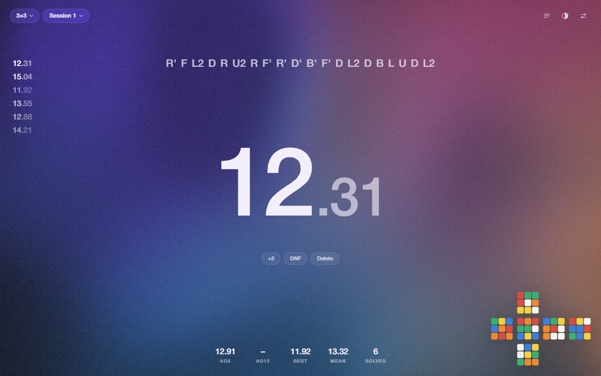

# Cube Timer

A minimal, good-looking speedcubing timer for Windows: a soft animated gradient, Helvetica Neue,
and an interface that blurs out of the way while you solve.



## Download

**[⬇ Download Cube-Timer.exe](../../releases/latest/download/Cube-Timer.exe)** (Windows 10/11, 64-bit)

It's a single portable file: no installer, just double-click it. The first launch takes a couple of seconds.
Windows SmartScreen may warn you because the exe isn't code-signed: click **More info → Run anyway**.

All releases are on the [Releases page](../../releases).

## Using it

| Key | Action |
| --- | --- |
| **Space** | Hold until the time turns green, release to start. Any key stops. |
| **Esc** | Cancel inspection / discard the running solve / close the panel |
| **← →** | Previous / next scramble |
| **2** · **D** · **⌫** | +2 · DNF · delete the last solve (delete has Undo) |
| **H** · **T** · **S** | Solves · Appearance · Settings |
| **F11** | Fullscreen |

With a mouse or touch screen, press and hold on empty space, then release. Tap to stop.

- **Events:** 2×2 – 7×7, Pyraminx, Megaminx, Skewb, Square-1, Clock, with any number of sessions each
- **Stats:** mo3, ao5, ao12, ao100 (WCA trimming, DNF-aware), best/current, a progress graph and full history
- **Recent times:** your latest times run down the left side; click one for details, scramble and penalties
- **Inspection:** optional 15 s with automatic +2 / DNF
- **Typing mode:** enter times by hand (`1234` → 12.34, `1:02.5`, `DNF`)
- **Data:** backup export/import and per-session CSV export

## Making it yours

**Appearance** (`T`) has ten colour schemes (Dusk, Aurora, Sunset, Ocean, Neon, Graphite, Paper, Lavender, Matcha, Bone).
Edit any colour and it becomes your own scheme. Tune the background's glow, pattern size, speed and film grain,
roll random dark/light schemes, and share schemes as JSON.

**Settings** (`S`) covers hold time, inspection, how the time shows while solving, decimals, timer size,
which pieces of the interface appear, background quality, and **Motion** (Full / Reduced).

> Motion is an in-app setting on purpose: Windows' "Animation effects" switch would otherwise turn the animations off.

## Font

The interface uses **Helvetica Neue Medium** from your system. It isn't bundled (it's a licensed font);
without it the app falls back to Helvetica, then Arial.

## Building from source

```sh
npm install
node node_modules/electron/install.js   # newer npm versions skip Electron's download step
npm start                               # run it
npm run dist                            # build dist/Cube-Timer.exe
```

The app itself is plain HTML/CSS/JS, so `index.html` also runs directly in a browser (data is then kept in that browser).

```
main.js / preload.js   Electron shell
index.html, styles.css page and styles
js/app.js              timer, sessions, UI, animations
js/scramblers.js       scramble generators
js/preview.js          cube net, drawn by simulating the scramble
js/stats.js            formatting, averages, time parsing
js/themes.js           colour schemes
js/background.js       WebGL gradient (static fallback without WebGL)
```

2×2 – 7×7, Pyraminx and Skewb use random-move scrambles rather than random-state ones.
